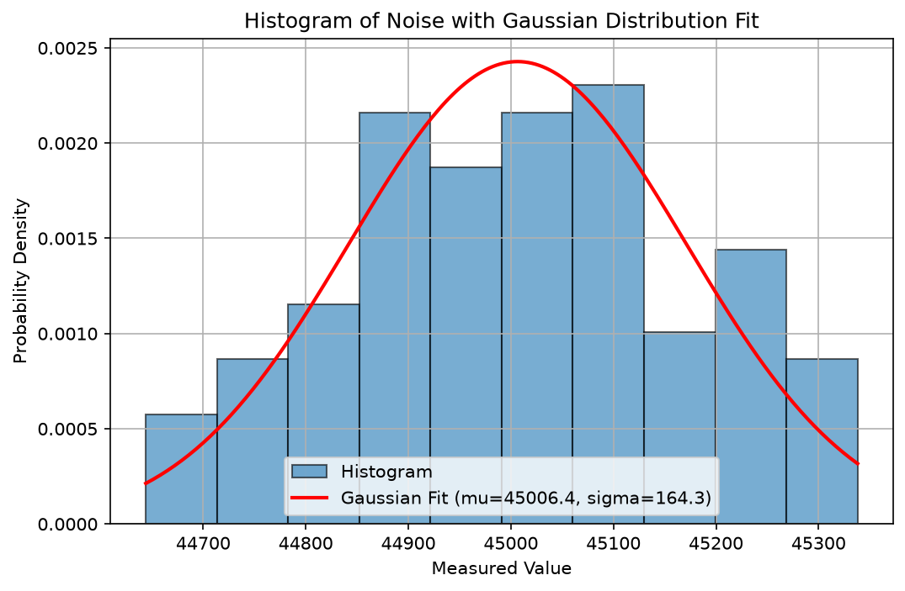

# Statistical Analysis of Sensor Noise Measurements


## 📌 Project Overview
This project performs statistical analysis on experimental sensor noise measurements recorded in `noise.csv`. It evaluates central tendency, dispersion, and probability distribution by fitting an analytical Gaussian (Normal) probability density function over an empirical histogram.

## 🔬 Mathematical Methodology

1. **Sample Mean ($\mu$)**:
   $$\mu = \frac{1}{N} \sum_{i=1}^{N} x_i$$

2. **Sample Standard Deviation ($\sigma$)**:
   $$\sigma = \sqrt{\frac{1}{N-1} \sum_{i=1}^{N} (x_i - \mu)^2}$$
   *(Computed with degrees of freedom `ddof=1` for unbiased sample estimation).*

3. **Gaussian Probability Density Function (PDF)**:
   $$f(x) = \frac{1}{\sigma \sqrt{2\pi}} \exp\left( -\frac{(x - \mu)^2}{2\sigma^2} \right)$$

---

## 📊 Results & Visualization

The script generates a normalized frequency histogram of the noise data and overlays the theoretical Gaussian curve:



* **Calculated Sample Mean**: `100.06`
* **Calculated Sample Standard Deviation**: `2.02`

---

## 📁 Repository Structure

```text
├── statistical_analysis_nachiketh.ipynb      # Main Jupyter notebook with data analysis & plots
├── noise.csv                                 # Experimental sensor noise dataset
├── statistical_analysis_nachiketh_histogram.png # High-resolution PNG plot
├── statistical_analysis_nachiketh_histogram.pdf # Vector PDF plot for publication/reports
├── README.md                                 # Project documentation
└── .gitignore                                # Git ignore configuration
```

---

## 🚀 Getting Started

### Prerequisites
Make sure you have Python installed along with the required libraries:
```bash
pip install numpy matplotlib jupyter
```

### Running the Notebook
1. Clone or download this repository:
   ```bash
   git clone <your-repo-url>
   cd <repo-folder>
   ```
2. Open the notebook in VS Code or Jupyter Notebook:
   ```bash
   jupyter notebook statistical_analysis_nachiketh.ipynb
   ```
3. Run all cells to inspect the statistics and regenerate the plots.
